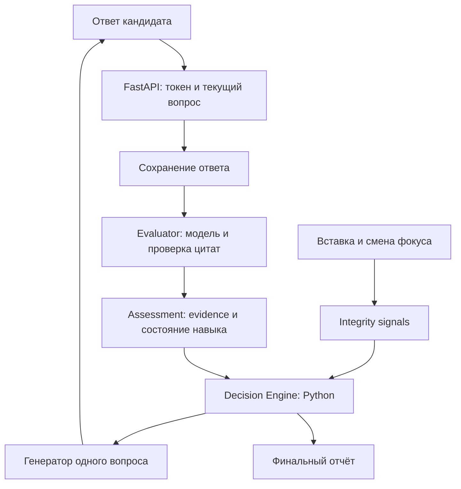

# Как работает MIMAS

## Технологии и границы

Интерфейс — Next.js, React и TypeScript. Сервер — FastAPI на Python.
SQLAlchemy работает с базой данных; локальное демо использует SQLite.
Gemini (основной провайдер) или Groq (ручной резерв) предоставляет модель по API: наш код отправляет ей отдельные задачи,
проверяет структуру ответа и связывает результат с состоянием интервью.
Собственную модель мы не обучаем.

Сейчас есть два сценария: прежнее демо с камерой и новый текстовый AI-runtime.
Unified Runtime подключён к «Попробовать AI». Наличие записи в старом демо
не означает, что новый runtime анализирует видео.

## Куда смотреть в коде

| Файл | Ответственность |
|---|---|
| `frontend/app/ai-demo.tsx` | Экран интервью: загрузка сессии, отправка ответа, показ вопроса |
| `frontend/app/ai-session.ts` | Типы ответов API и функция HTTP-запроса |
| `frontend/app/use-integrity-events.ts` | Наблюдаемые события, очередь в sessionStorage, отправка без потери новых событий |
| `frontend/app/answer-report.tsx` | Баллы и разбор ответа с подсветкой цитат |
| `frontend/app/integrity-summary.tsx` | История наблюдений и проверок понимания |
| `backend/ai_web.py` | Маршруты, проверка токена, блокировка сессии, сохранение и восстановление |
| `backend/ai_presenter.py` | Разрешённые для кандидата поля ответа API |
| `backend/database.py` | SQLAlchemy и транзакции базы |
| `ai_core/interview/state.py` | Полное сохраняемое состояние интервью |
| `ai_core/interview/engine.py` | Последовательность этапов и контрольные точки |
| `ai_core/interview/assessment.py` | Применение оценки: evidence, misconceptions, проверки, состояние навыка |
| `ai_core/interview/decision_engine.py` | Выбор следующего действия обычным Python-кодом |
| `ai_core/interview/events.py` | Структуры событий, сигналов, противоречий, результатов проверок |
| `ai_core/interview/integrity.py` | Преобразование наблюдений в сигналы и правила исходов проверки |
| `ai_core/evaluation/evaluator.py` | Вызов модели для оценки, проверка JSON и цитат, обработка ошибок |
| `ai_core/interview/question_selector.py` | Формулировка одного вопроса по уже выбранной цели; резервный вопрос |
| `ai_core/llm/factory.py` | Выбор провайдера и конфигурация на сервере |
| `ai_core/llm/gemini.py` | Официальный google-genai SDK, schema, thinking, retries и usage |
| `ai_core/llm/provider.py` | HTTP-вызов Groq; отдельные fake/offline провайдеры для тестов |
| `ai_core/reports/generator.py` | Итоговый отчёт на основании сохранённого состояния |
| `ai_core/reports/answer_review.py` | Перевод структурированной оценки в прозрачную шкалу 0–5 |

## Путь одного ответа

1. Кандидат вводит текст. Перед отправкой интерфейс доставляет накопленные события.
2. API проверяет токен и ID текущего вопроса. Повтор того же ответа не создаёт дубликат.
3. Движок сохраняет ответ и фазу EVALUATE_ANSWER **до** обращения к модели.
4. Evaluator отправляет вопрос, ответ и относящийся к теме предыдущий контекст выбранному провайдеру.
   «Не знаю» обрабатывается без придумывания ошибок; цитаты проверяются по исходному тексту.
5. Assessment превращает валидный результат в факты с источниками, обновляет навык,
   ошибочные представления и результат целевой проверки.
6. Состояние сохраняется. Decision Engine выбирает: уточнить, проверить, задать основной
   вопрос, перейти к следующему навыку или завершить.
7. Генератор получает конкретную цель и формулирует вопрос. Он не выбирает ход интервью.
8. Вопрос сохраняется. Presenter возвращает интерфейсу публичные поля без внутренней
   уверенности, подозрений и отрицательных свидетельств во время интервью.

## Пример большой вставки

При вставке 900 символов сохраняется событие с размером и ID вопроса.
Содержимое буфера обмена отдельно не отправляется: текст уйдёт только как ответ,
если кандидат его отправит. Большая вставка создаёт сигнал для проверки.
При наличии бюджета вопросов движок просит объяснить ответ своими словами.

Хорошее объяснение закрывает этот сигнал. Явная техническая ошибка фиксируется
с цитатой. Отказ, неоднозначность или сбой модели оставляют неопределённость.
Сам факт вставки не уменьшает балл и не доказывает списывание.

## Сохранение и восстановление

В таблице `ai_sessions` хранятся JSON-state, trace решений, незавершённый ответ,
модель, время начала и хеш токена. Контрольная точка сохраняет их согласованно
в одной транзакции. Сессии, созданные после ревью, также содержат снимок плана:
новое развёртывание не меняет их порядок компетенций.

После reload браузер восстанавливает доступ из sessionStorage и читает серверное
состояние. При прерванной обработке кнопка продолжения вызывает resume().
Готовая сохранённая оценка не пересчитывается. Если процесс умер до сохранения ответа
модели, этот сетевой вызов может повториться. Это не гарантия однократного списания
токенов у провайдера.

## Отчёт и баллы

Отчёт строится из накопленных данных без нового запроса к модели. В нём видны
ответы, подтверждения, ошибки, пробелы, баллы и проверки понимания. Балл 0–5
вычисляется кодом по корректности и глубине, определённым AI. «Не оценено»
отличается от нуля. Уровень навыка — отдельная предварительная агрегация.
Решение о найме система не принимает.

## Что исправлено при ревью

1. Переполнение очереди наблюдений раньше возвращало постоянную ошибку, из-за чего
   клиент не доходил до отправки ответа/завершения. Теперь API подтверждает обработку
   запроса с `accepted=false, reason=event_limit`, очередь освобождается, а отчёт
   сообщает о неполной истории.
2. Восстановленная генерация могла вызвать LLM после истечения времени интервью.
   Теперь время проверяется до вызова провайдера.
3. План компетенций раньше загружался заново при каждом восстановлении. Теперь
   новые сессии сохраняют его снимок. Старые состояния без снимка совместимы,
   но используют текущий план, поскольку историческую версию восстановить невозможно.

Обработка оценки, публичная проекция API, HTTP-типы, очередь наблюдений и UI истории
проверок выделены в самостоятельные модули. Контракты существующих маршрутов сохранены.

## Проверка и ограничения

83 Python-теста, production-сборка и scripted browser smoke прошли после изменений.
Регрессии покрывают все три исправленных случая. Браузерный тест проходит через
настоящие FastAPI/SQLite с отдельным явно обозначенным тестовым провайдером;
он не доказывает качество реального AI.

Текущая блокировка сессий рассчитана на один процесс сервера. Перед запуском
нескольких workers нужна блокировка/контроль версии на уровне базы. Клиентские
события не защищены от подделки. Качество LLM-оценок требует отдельного набора
эталонных ответов. Это ограничения прототипа, а не исправленные этим ревью задачи.
